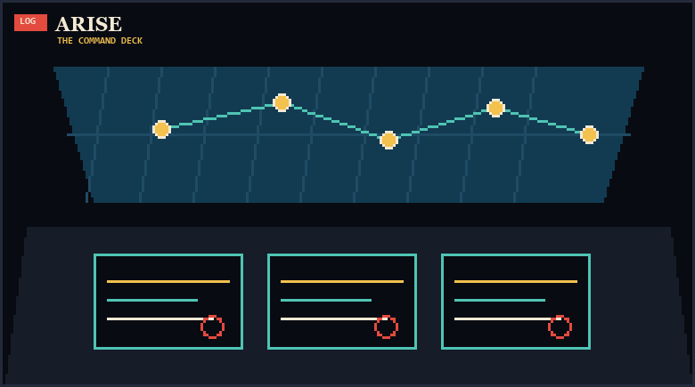
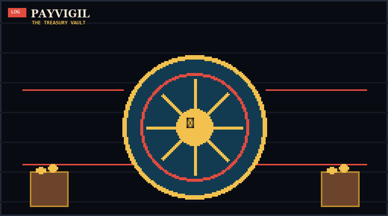
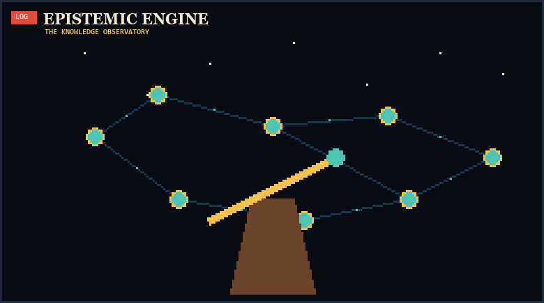
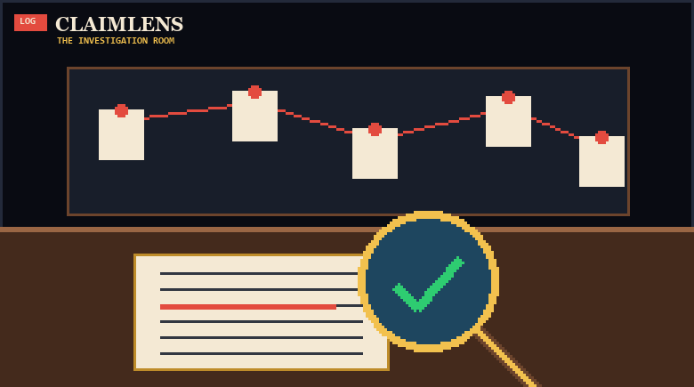
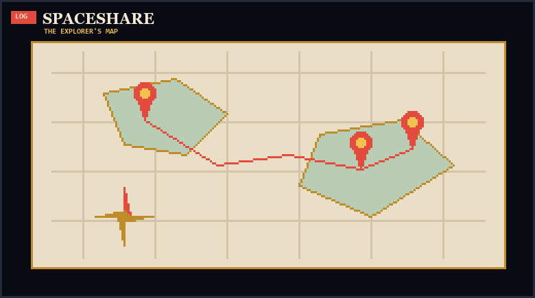
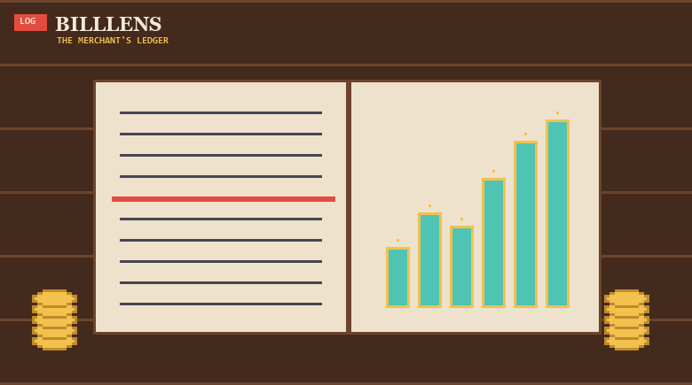

<!-- CINEMATIC HERO BANNER (35% LUFFY THREE-QUARTER COMPOSITION) -->

  

<!-- ABOUT ME: EDITORIAL MINIMALISM -->
<h2>Hey, I'm Prem!</h2>

  <b>AI enthusiast and full-stack developer from Bengaluru, India.</b> 
  I love building creative projects, exploring artificial intelligence, and turning ideas into real applications.

  
  &nbsp;
  
  &nbsp;
  

 

<!-- TRANSITION ACCENT -->

  

<!-- TECH STACK: ICONS ONLY (CLEAN COMPOSITION, NO OUTLINE BOXES) -->
<table border="0" cellpadding="0" cellspacing="16" align="center">
  <tr>
    <td align="center" valign="middle">
      <b>AI DEVELOPMENT</b>
        
      
    </td>
    <td width="48"></td>
    <td align="center" valign="middle">
      <b>FULL-STACK DEVELOPMENT</b>
        
      

        
        &nbsp;&nbsp;&nbsp;
        
        &nbsp;&nbsp;&nbsp;
        
        &nbsp;&nbsp;&nbsp;
        
        &nbsp;&nbsp;&nbsp;
        
        &nbsp;&nbsp;&nbsp;
        
        &nbsp;&nbsp;&nbsp;
        
      

    </td>
  </tr>
</table>

  

<!-- THE GRAND LINE: IMMERSIVE PIXEL WORLDS -->
<h2>THE GRAND LINE</h2>

<i>Featured open-source expeditions and systems</i>

<table border="0" cellpadding="0" cellspacing="14" width="100%">
  <tr>
    <td width="50%" align="center" valign="top">
      
      

        <b><a href="https://github.com/Prem17th/Arise">ARISE</a></b> 
        Local-first AI agent orchestrator with 231 typed capabilities, cryptographic approval gates, and sandboxed execution.
      

    </td>
    <td width="50%" align="center" valign="top">
      
      

        <b><a href="https://github.com/Prem17th/PayVigil">PayVigil</a></b> 
        AI-assisted payment investigation platform for Indian MSMEs with evidence review and immutable approval workflows.
      

    </td>
  </tr>
  <tr>
    <td width="50%" align="center" valign="top">
      
      

        <b><a href="https://github.com/Prem17th/Epistemic-Engine">Epistemic Engine</a></b> 
        Multi-document process compiler that builds evidentiary DAGs, detects contradictions, and models deadline risk via Monte Carlo.
      

    </td>
    <td width="50%" align="center" valign="top">
      
      

        <b><a href="https://github.com/Prem17th/ClaimLens">ClaimLens</a></b> 
        Evidence-driven misinformation detection system with ML style analysis, external fact-checking, and audit logging.
      

    </td>
  </tr>
  <tr>
    <td width="50%" align="center" valign="top">
      
      

        <b><a href="https://github.com/Prem17th/SpaceShare">SpaceShare</a></b> 
        Shared-space marketplace with search, host dashboards, interactive maps, QR verification, and AI-powered trip planning.
      

    </td>
    <td width="50%" align="center" valign="top">
      
      

        <b><a href="https://github.com/Prem17th/BillLens">BillLens</a></b> 
        Autonomous MSME financial intelligence platform with invoice auditing, cash-flow forecasting, and underwriting scoring.
      

    </td>
  </tr>
</table>

  

<!-- CINEMATIC MOONLIT FOOTER -->

 

One Piece × Pixel Cinema × Modern Engineering. © Prem T H

