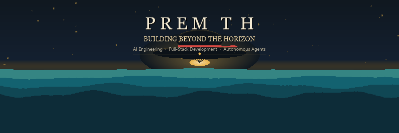
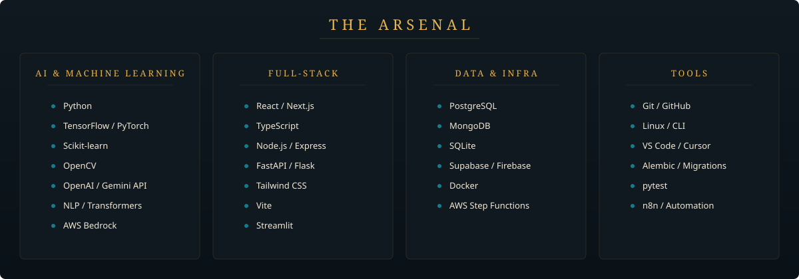
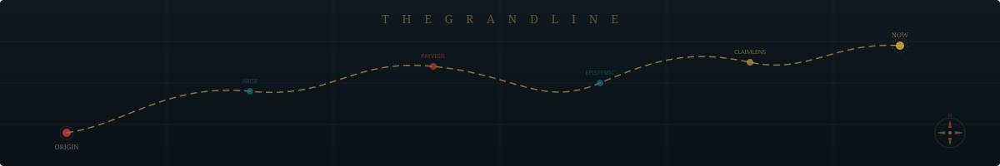
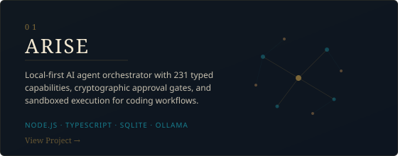
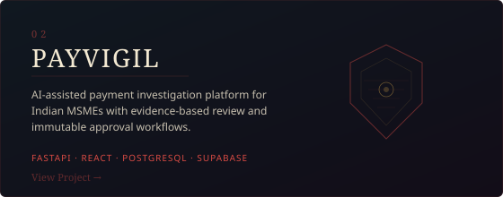
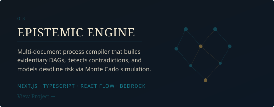
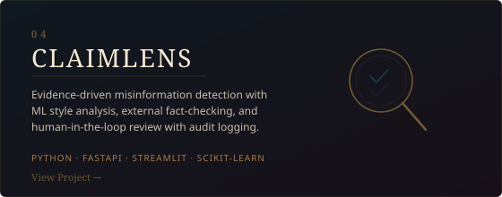
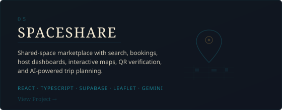
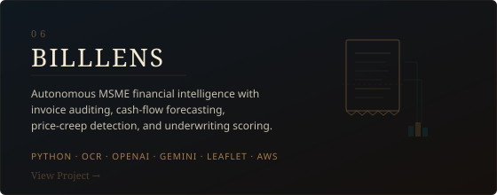

  

 

### *“If you don't take risks, you can't create a future.”*

  <b>Prem T H</b> · Software Engineer & AI Researcher based in <b>Bengaluru, India</b>. 
  Studying Computer Applications at M. S. Ramaiah College of Arts, Science and Commerce. 
  Forging autonomous agent runtimes, evidentiary reasoning engines, and resilient full-stack systems.

  
  &nbsp;
  
  &nbsp;
  

 

  

  

 

  

<!-- PROJECTS GRID -->
<table border="0" cellpadding="0" cellspacing="8" width="100%">
  <tr>
    <td width="50%" align="center" valign="top">
      
    </td>
    <td width="50%" align="center" valign="top">
      
    </td>
  </tr>
  <tr>
    <td width="50%" align="center" valign="top">
      
    </td>
    <td width="50%" align="center" valign="top">
      
    </td>
  </tr>
  <tr>
    <td width="50%" align="center" valign="top">
      
    </td>
    <td width="50%" align="center" valign="top">
      
    </td>
  </tr>
</table>

  

 

 

Crafted with passion, grit, and the spirit of the Grand Line. © Prem T H

